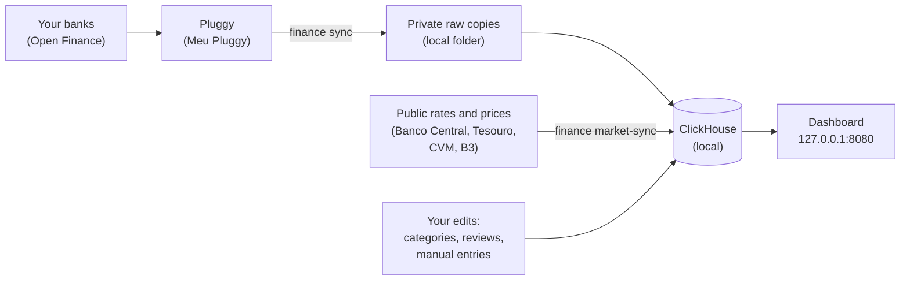

# Personal Finance Platform

🇧🇷 [Leia em português](README.pt-BR.md)

A personal finance dashboard for Brazilian bank accounts that runs entirely on your
machine. Account, card and investment data come from
[Open Finance Brasil](https://openfinancebrasil.org.br), accessed through
[Pluggy](https://pluggy.ai); public rates and prices value the investments.



## 1. Connect your banks through Pluggy

Pluggy gives free personal access to your own Open Finance data through
[Meu Pluggy](https://meu.pluggy.ai): up to 5 connections, no commercial use. See
Pluggy's [personal use guide](https://docs.pluggy.ai/en/docs/guides/meu-pluggy-personal-use).

1. Sign up at [meu.pluggy.ai](https://meu.pluggy.ai) and authorize each bank. Each
   consent is valid for 12 months.
2. Sign in to the [Pluggy Dashboard](https://dashboard.pluggy.ai) with the same
   account and create an application under **Applications**. Keep its Client ID and
   Client Secret in your password manager; the secret is shown only once.
3. On the application's **Demo** page, click **Connect Account** and choose the
   **MeuPluggy** connector, not your bank's. Copy the id of each item under
   **Connected Items**.

## 2. Install and run

Requirements: Windows with PowerShell 5.1+, Python 3.12, [uv](https://docs.astral.sh/uv/),
Node 24 and Docker Desktop (Linux engine, at least 6 GB of memory). From the
repository root:

```powershell
.\scripts\bootstrap.ps1     # once: creates the private data folder and secrets
.\scripts\run_local.ps1     # starts the database, the dashboard and the updater
Start-Process http://127.0.0.1:8080
```

`bootstrap.ps1` keeps data and secrets outside Git, in
`%LOCALAPPDATA%\PersonalFinancePhase0` by default. Use a disk with encryption and
keep an independent backup.

To look around first without a Pluggy account, run
`uv run --frozen finance demo-spending` and pick **Synthetic demo** in the
connection selector.

To stop everything: `docker compose --env-file .env -f infra/compose.yaml down`.

## 3. Update your data

Save the Pluggy credentials once in `secrets\pluggy.env` inside the private folder
(`%LOCALAPPDATA%\PersonalFinancePhase0\secrets\pluggy.env` by default). The private
folder is outside Git and cloud sync and readable only by your Windows user:

```ini
PLUGGY_CLIENT_ID=<client id>
PLUGGY_CLIENT_SECRET=<client secret>
PLUGGY_ITEM_IDS=["<item id>", "<another item id>"]
```

Environment variables with the same names take precedence over the file.

Then update in either of two ways:

- **From the dashboard:** the badge in the header shows when the data was last
  updated. Open it to see each connection's last update and click **Update now**.
  `run_local.ps1` starts the background updater that runs the request; the badge
  warns when it is not running.
- **From PowerShell:**

  ```powershell
  .\scripts\sync.ps1          # bank data, then public rates and prices
  .\scripts\sync.ps1 -Full    # read the whole available history again
  ```

Only one update runs at a time. The first one reads all available history; later
ones read what is new plus the last 45 days, so status changes and reversals are
picked up. Meu Pluggy refreshes its data from the banks every 24 hours, so updating
more than once a day brings nothing new. When a consent expires, reads come back
empty: connect MeuPluggy again (step 3 above) and check whether the item id changed.

## Backup and restore

A backup is one `.zip` file with your edits (categories, rules, reviews, manual
entries, investment classes and disabled accounts) as Parquet tables, plus the
original Pluggy responses. Public rates and prices are left out; `market-sync`
downloads them again. Keep the original responses: Pluggy does not promise to keep
your whole history.

- **From the dashboard:** open the header badge, click **Export backup** and then
  **Download backup**; to restore, click **Import backup** and pick the file.
- **From PowerShell:**

  ```powershell
  .\scripts\export.ps1                  # saved in exports\ inside the private folder
  .\scripts\import.ps1 -Path <file.zip>
  ```

Importing only adds what is missing: new original responses are stored and
processed, and edits the database already has are skipped. Nothing is deleted or
overwritten, so importing the same file twice changes nothing. To move to another
computer, run steps 1 and 2 there and import the file. The archive holds your
financial data: keep it somewhere private, not in this repository or a shared folder.

## What the dashboard shows

| Tab | What you see |
|---|---|
| **Overview** | Spending this month vs. the previous one, month pace against the 6‑month average, where the money went (spent vs. invested), net worth and 12‑month investment return. |
| **Monthly spending** | 12‑month comparison, categories vs. the previous month, spending by category over time, upcoming card spending (installments already committed), a categories‑by‑month table and the list of expenses, where you set categories. |
| **To review** | Debits the rules cannot classify on their own, such as a PIX to a person, and money that left a savings box without a reported payment. Include or exclude each one. |
| **Investments** | Positions and savings boxes by month, contributions and withdrawals, and returns compared with the CDI, grouped into classes you define. |
| **Accounts** | Each account and card with its balance, limit and details. Disable an account to leave it out, for example a duplicated card. |
| **Categories** | Your two‑level categories. An optional local AI model can suggest categories; you approve each one. |

All screens filter by connection and month and are available in English and
Brazilian Portuguese.

## What counts

- **Spending:** card purchases (including pending ones, marked as such until the
  bill closes) and account debits the bank files under a consumption category, such
  as a bill paid by PIX or boleto. Refunds are subtracted.
- **Not spending:** card bill payments, transfers between your own accounts,
  investment and savings‑box movements, and cashback.
- **Your input:** debits you include in **To review**, and manual or recurring
  entries for payments the bank does not report. An entry with the payee's CNPJ is
  skipped in months that already have a reported payment to it, so nothing counts
  twice.
- **Net worth:** investments and bank balances minus everything the cards owe,
  including future installments. It reflects the latest balances, not history.
- **Disabled accounts** are left out of spending and of account and card balances.

Categories come from the bank's category and the merchant, and every change you make
becomes a rule for similar transactions.

## Privacy

Raw Pluggy responses, the database and your edits stay in the private folder on your
machine. The dashboard listens only on `127.0.0.1`, and the optional AI model runs
locally through Ollama. `market-sync` downloads whole public series, so those sources
learn nothing about your portfolio; the one exception is a stock missing from B3's
files, whose ticker is asked for by name from Yahoo Finance.

## Development

`.\scripts\check.ps1` runs lint, tests and the frontend build. Code, documentation and
commit messages are in English; interface strings are translated with
`npm --prefix apps/web run translate`. Architecture, data contracts and runbooks are in
[`docs/`](docs): start with [architecture](docs/architecture.md),
[spending rules](docs/spending.md), [provider ingestion](docs/provider-ingestion.md)
and [operations](docs/operations-runbook.md).
