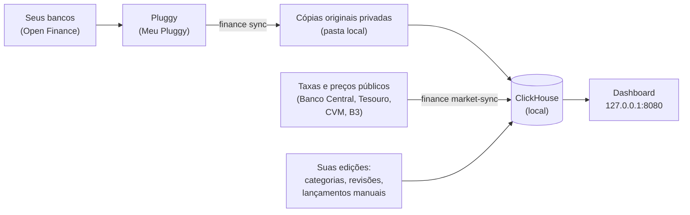

# Personal Finance Platform

🇺🇸 [Read in English](README.md)

Um dashboard de finanças pessoais para contas de bancos brasileiros que roda
inteiramente na sua máquina. Os dados de contas, cartões e investimentos vêm do
[Open Finance Brasil](https://openfinancebrasil.org.br), acessados por meio da
[Pluggy](https://pluggy.ai); taxas e preços públicos avaliam os investimentos.



## 1. Conecte seus bancos pela Pluggy

A Pluggy oferece acesso gratuito aos seus próprios dados do Open Finance pelo
[Meu Pluggy](https://meu.pluggy.ai): até 5 conexões, sem uso comercial. Veja o
[guia de uso pessoal](https://docs.pluggy.ai/en/docs/guides/meu-pluggy-personal-use)
da Pluggy.

1. Crie uma conta em [meu.pluggy.ai](https://meu.pluggy.ai) e autorize cada banco.
   Cada consentimento vale por 12 meses.
2. Entre no [Dashboard da Pluggy](https://dashboard.pluggy.ai) com a mesma conta e
   crie uma aplicação em **Applications**. Guarde o Client ID e o Client Secret no
   seu gerenciador de senhas; o secret aparece uma única vez.
3. Na página **Demo** da aplicação, clique em **Connect Account** e escolha o
   conector **MeuPluggy**, não o do seu banco. Copie o id de cada item em
   **Connected Items**.

## 2. Instale e rode

Requisitos: Windows com PowerShell 5.1+, Python 3.12, [uv](https://docs.astral.sh/uv/),
Node 24 e Docker Desktop (motor Linux, pelo menos 6 GB de memória). Na raiz do
repositório:

```powershell
.\scripts\bootstrap.ps1     # uma vez: cria a pasta privada de dados e os segredos
.\scripts\run_local.ps1     # sobe o banco de dados, o dashboard e o atualizador
Start-Process http://127.0.0.1:8080
```

O `bootstrap.ps1` guarda dados e segredos fora do Git, por padrão em
`%LOCALAPPDATA%\PersonalFinancePhase0`. Use um disco com criptografia e mantenha um
backup independente.

Para conhecer antes sem conta na Pluggy, rode `uv run --frozen finance demo-spending`
e escolha **Synthetic demo** no seletor de conexão.

Para desligar tudo: `docker compose --env-file .env -f infra/compose.yaml down`.

## 3. Atualize os dados

Salve as credenciais da Pluggy uma vez em `secrets\pluggy.env`, dentro da pasta
privada (por padrão `%LOCALAPPDATA%\PersonalFinancePhase0\secrets\pluggy.env`). A pasta
privada fica fora do Git e da sincronização com a nuvem e só o seu usuário do Windows
pode lê-la:

```ini
PLUGGY_CLIENT_ID=<client id>
PLUGGY_CLIENT_SECRET=<client secret>
PLUGGY_ITEM_IDS=["<id do item>", "<outro id de item>"]
```

Variáveis de ambiente com os mesmos nomes têm prioridade sobre o arquivo.

Depois, atualize de um destes dois jeitos:

- **Pelo dashboard:** o selo no cabeçalho mostra quando os dados foram atualizados
  pela última vez. Abra-o para ver a última atualização de cada conexão e clique em
  **Atualizar agora**. O `run_local.ps1` inicia o atualizador em segundo plano, que
  executa o pedido; o selo avisa quando ele não está rodando.
- **Pelo PowerShell:**

  ```powershell
  .\scripts\sync.ps1          # dados dos bancos, depois taxas e preços públicos
  .\scripts\sync.ps1 -Full    # lê de novo todo o histórico disponível
  ```

Só uma atualização roda por vez. A primeira lê todo o histórico disponível; as
seguintes leem o que é novo mais os últimos 45 dias, para pegar mudanças de status e
estornos. O Meu Pluggy atualiza os dados dos bancos a cada 24 horas, então atualizar
mais de uma vez por dia não traz nada novo. Quando um consentimento expira, as
leituras voltam vazias: conecte o MeuPluggy de novo (passo 3 acima) e confira se o
id do item mudou.

## Backup e restauração

Um backup é um único arquivo `.zip` com as suas edições (categorias, regras,
revisões, lançamentos manuais, classes e metas de investimento e contas desativadas) em
tabelas Parquet, mais as respostas originais da Pluggy. Taxas e preços públicos ficam
de fora; o `market-sync` baixa de novo. Guarde as respostas originais: a Pluggy não
garante manter todo o seu histórico.

- **Pelo dashboard:** abra o selo do cabeçalho, clique em **Exportar backup** e
  depois em **Baixar backup**; para restaurar, clique em **Importar backup** e
  escolha o arquivo.
- **Pelo PowerShell:**

  ```powershell
  .\scripts\export.ps1                  # salvo em exports\ dentro da pasta privada
  .\scripts\import.ps1 -Path <arquivo.zip>
  ```

Importar só adiciona o que falta: respostas originais novas são guardadas e
processadas, e edições que o banco de dados já tem são ignoradas. Nada é apagado nem
sobrescrito, então importar o mesmo arquivo duas vezes não muda nada. Para levar a
outro computador, faça os passos 1 e 2 nele e importe o arquivo. O arquivo contém os
seus dados financeiros: guarde-o em local privado, não neste repositório nem numa
pasta compartilhada.

## O que o dashboard mostra

| Aba | O que você vê |
|---|---|
| **Visão geral** | Gasto do mês contra o anterior, ritmo do mês contra a média de 6 meses, para onde foi o dinheiro (gasto x investido), patrimônio líquido e rentabilidade dos investimentos em 12 meses. |
| **Gastos mensais** | Comparativo de 12 meses, categorias contra o mês anterior, gastos por categoria ao longo do tempo, gastos futuros no cartão (parcelas já comprometidas), tabela de categorias por mês e a lista de despesas, onde você define as categorias. |
| **Pendências** | Débitos que as regras não conseguem classificar sozinhas, como um PIX para uma pessoa, e dinheiro que saiu de uma caixinha sem pagamento informado. Inclua ou exclua cada um. |
| **Investimentos** | Posições e caixinhas mês a mês, aportes e resgates, e rentabilidade comparada ao CDI, agrupadas em classes que você define, mais uma alocação alvo: defina a participação que quer em cada classe e veja como dividir um valor a investir, sem vender nada, para chegar o mais perto possível dela. |
| **Contas** | Cada conta e cartão com saldo, limite e detalhes. Desative uma conta para deixá‑la de fora, por exemplo um cartão duplicado. |
| **Categorias** | Suas categorias em dois níveis. Um modelo de IA local opcional pode sugerir categorias; você aprova cada uma. |

Todas as telas filtram por conexão e mês e estão disponíveis em português e inglês.

## O que entra na conta

- **Gastos:** compras no cartão (inclusive as pendentes, marcadas assim até a fatura
  fechar) e débitos em conta que o banco classifica como consumo, como uma conta paga
  por PIX ou boleto. Estornos são descontados.
- **Não são gastos:** pagamento de fatura, transferências entre suas contas,
  movimentações de investimentos e caixinhas, e cashback.
- **O que você informa:** débitos incluídos em **Pendências** e lançamentos manuais
  ou recorrentes para pagamentos que o banco não informa. Um lançamento com o CNPJ do
  favorecido é ignorado nos meses que já têm um pagamento informado para ele, para
  nada contar duas vezes.
- **Patrimônio líquido:** investimentos e saldos em conta menos tudo o que os cartões
  devem, inclusive parcelas futuras. Reflete os saldos mais recentes, não um histórico.
- **Contas desativadas** ficam fora dos gastos e dos saldos de contas e cartões.

As categorias vêm da categoria do banco e do estabelecimento, e cada mudança que você
faz vira regra para transações parecidas.

## Privacidade

As respostas originais da Pluggy, o banco de dados e suas edições ficam na pasta
privada da sua máquina. O dashboard só escuta em `127.0.0.1`, e o modelo de IA
opcional roda localmente pelo Ollama. O `market-sync` baixa séries públicas inteiras,
então essas fontes não ficam sabendo nada da sua carteira; a única exceção é uma ação
ausente dos arquivos da B3, cujo código é pedido pelo nome ao Yahoo Finance.

## Desenvolvimento

O `.\scripts\check.ps1` roda lint, testes e o build do frontend. Código, documentação
e mensagens de commit ficam em inglês; os textos da interface são traduzidos com
`npm --prefix apps/web run translate`. Arquitetura, contratos de dados e runbooks
estão em [`docs/`](docs), em inglês.
